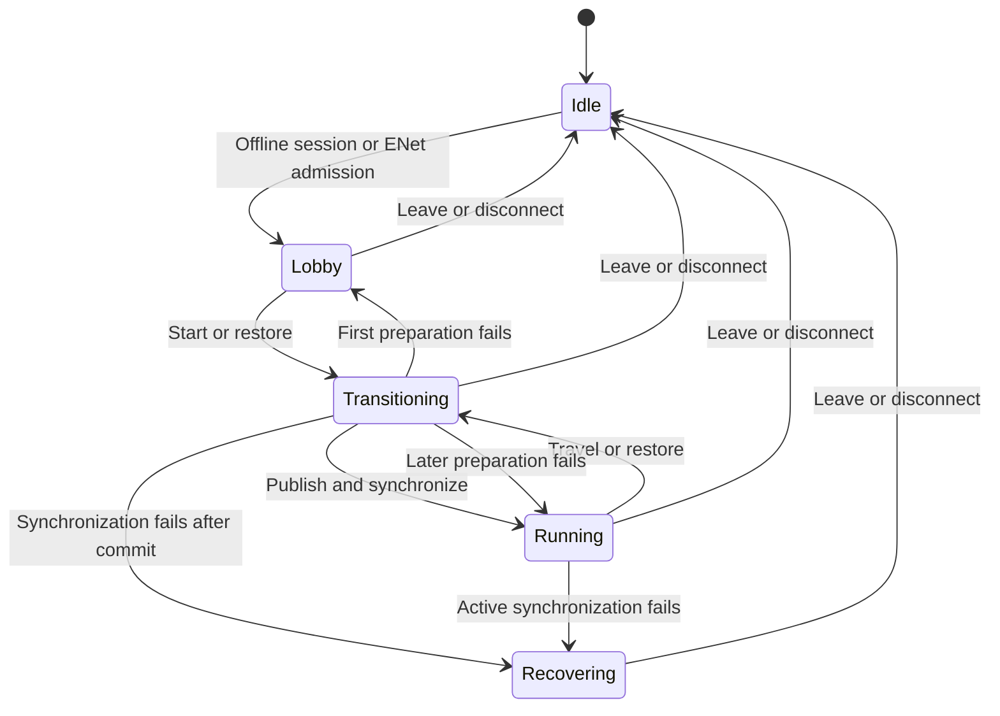

<!-- Copyright Francesco Di Blasi 2026 - All Rights Reserved -->

# Crimson Framework architecture

This specification maps the native C++ add-on for offline, listen-server, and dedicated-server games. Each player can have zero or one primary character. Each character can have zero or one primary player controller. Changing possession leaves both character records in the match. See the [public API guide](PUBLIC_API.md) for the integrated Godot entry point and standalone access.

## Identity and ownership

| Identity | Meaning | Lifetime |
| --- | --- | --- |
| `PeerId` | The connection assigned by the transport | One connection |
| `PlayerId` | A game-issued participant identity. The game can resolve it from an account or a local profile | Across reconnects when the game supports them |
| `MatchId` | The active match, campaign run, or playthrough | One run |
| `CharacterId` | One character instance, including AI and unpossessed units | Until the game despawns that character |
| `WorldId` | A game-owned region or simulation space with its own state | Across scene loads and saves when the game persists it |
| `SceneId` | A registered scene asset used to present a world | Asset identity |
| Scene node | The currently mounted Godot object bound to a character or world record | One mount |

The game defines its state schemas. Player records can hold team, score, or draft choices. Character records can hold health, abilities, cooldowns, and inventory references. World records can hold objectives and persistent objects. A scene can unload while its records remain. A respawn can reuse a character record or create a new one according to game rules.

The authority commits gameplay changes. In offline mode it runs locally. In networked mode it runs on the host or dedicated server. A remote client receives the state it is allowed to see. Each record has one owning system. The Transaction Coordinator coordinates access, revisions, and capture across registered stores, so a native inventory grid can keep ownership of its placement rules.

## Module map and APIs

One native add-on registers Match Runtime, Multiplayer, Scene Loading, Persistence, and Inventory through `crimson_framework_init`. The integration layer implements Game Flow by composing those modules. Replication belongs to Multiplayer alongside Game Session. The game supplies rules and schemas to the framework.

| Module or subsystem | Status | Responsibility and public API |
| --- | --- | --- |
| **Multiplayer · Game Session** | Implemented | Owns offline and ENet transport, connection admission, and peer lifecycle. `start_offline()`, `host(port, ...)`, `join(address, port, ...)`, `leave()`, `is_authority()`, `get_connected_peer_ids()`, `set_accepting_connections(enabled)`. Signals include `session_started`, `peer_joined`, `peer_left`, and `session_ended`. [Session API](../src/modules/session/README.md) |
| **Scene Loader** | Implemented | Owns scene registration and coordinated activation. `set_world_container(node)`, `register_scene(scene_id, path)`, `request_load(scene_id)`, `request_coordinated_load(scene_id, publish_state)`, and `get_current_scene_id()`. Signals include `load_started`, `load_completed`, `load_failed`, and `load_sync_failed`. [Scene Loader API](../src/modules/scene_load/README.md) |
| **Save Coordinator** | Implemented | Owns versioned checkpoint I/O and detached restore staging. `register_participant(id, version, adapter)`, `request_save(profile, slot, metadata)`, `capture_pending(revision)`, `request_prepare_load(profile, slot)`, `get_prepared_candidate(ticket)`, and `activate_prepared_load(ticket)`. [Save API](../src/modules/save/docs/API.md) |
| **Inventory** | Implemented | Owns grid placement and atomic inventory operations. `try_place`, `try_move`, `try_transfer`, `export_snapshot`, and `import_snapshot`. A character, player, or world container can reference an inventory according to game rules. [Inventory API](../src/modules/inventory/MODEL.md) |
| **Match Runtime · Game Flow** | Implemented for offline and lobby-admitted ENet | `CrimsonGame` owns readiness, command gates, and coordinated scene and checkpoint activation. `CrimsonGameDefinition` declares the catalog and save configuration. `save_slot(profile, slot)` returns a fluent slot handle. `CrimsonGameOperation` exposes terminal results for start, travel, save, restore, history, and command submission. [Integrated API](PUBLIC_API.md) |
| **Integration · Immediate Play** | Implemented for a fixed 3D world | `CrimsonGame` injects its shared Game Session and Scene Loader into World Session. Solo, listen, dedicated, and late guests all mount through Scene Load. The authority assigns placements discovered from world-local spawn components. [Immediate-play API](PUBLIC_API.md#start-a-game) |
| **Match Runtime · Player Bindings** | Implemented | `CrimsonPlayerBindings` maps a trusted, admitted peer to one stable player ID. `bind_peer(peer_id, player_id)`, `get_player(peer_id)`, `get_binding_generation(peer_id)`, and `unbind_peer(peer_id, generation)`. Binding generations prevent a stale disconnect from removing a newer binding. The game verifies identity before binding. |
| **Match Runtime · State and Transactions** | Implemented for registered DTO stores | `CrimsonTransactionCoordinator` owns the store registry, detached reads, and publication revisions. It stages transactions and snapshots, validates a detached restore, and publishes every prepared store at one revision. Game Flow uses a checkpoint adapter to pair that publication with scene activation. [Transaction contract](#transaction-contract) |
| **Match Runtime · Possession** | Implemented | `CrimsonPossession` owns writes to the primary-control relationship. `get_primary(player_id)`, `get_controller(character_id)`, `get_revision(player_id)`, `try_set_primary(player_id, character_id, expected_revision)`, and `queue_primary_change(transaction, player_id, character_id, expected_revision)`. An empty character ID releases control. |
| **Match Runtime · Command Router** | Implemented | `CrimsonCommandRouter` runs the same intent path for local and remote players. `register_handler(command_type, handler, requires_primary)`, `submit(player_id, intent)`, `set_accepting_commands(enabled)`, and `advance_world(world_epoch)`. It receives a player ID resolved by trusted ingress and validates the intent before dispatch. |
| **Multiplayer · Replication** | Implemented for bounded, recipient-specific committed views | `CrimsonReplication` sends initial baselines and subsequent upserts and removals. `set_projector(callback)`, `register_peer(peer_id, player_id, binding_generation)`, `advance_world(world_epoch, revision)`, `send_baseline(peer_id)`, and `publish_changes(revision)`. The game supplies visibility policy. [Replication API](../src/modules/replication/README.md) |

## Dependency direction

Match Runtime depends on Godot data and game-supplied rules. Multiplayer ingress resolves an admitted sender through Player Bindings and calls the transport-neutral Command Router. Local input supplies a trusted local player ID to the same router. Possession uses transaction stores for its assignments. Replication consumes detached committed views. Scene Loader and Game Session share a Godot multiplayer scope and matching node paths.

The persistent `CrimsonGame` node resolves Session and Scene Loader from its game scope and owns the injected nodes. The global `Crimson` facade resolves published game scopes weakly. A checkpoint adapter translates the registered stores into detached save data. Inventory retains ownership of placement validation, and its transaction adapter lives in the integration layer. Scene nodes bind to authoritative records by stable ID when mounted. Match services live outside the managed scene.

At the source boundary, Match Runtime, Game Session, Replication, Scene Loading, Persistence, and Inventory build against Godot and their own contracts. The integration layer can include the APIs it adapts. Runtime callbacks carry data across these interfaces without introducing a reverse source dependency.

| Integration folder | Ownership |
| --- | --- |
| [Game](../src/integration/game/) | `CrimsonGame`, the game-scoped service container, public facades, and the integrated session, checkpoint, and readiness lifecycle. |
| [World Session](../src/integration/world_session/) | Fixed-world mounting, authority spawn selection, and local presentation bindings. |
| [Adapters](../src/integration/adapters/) | Cross-module bridges, such as inventory participation in match transactions. |
| [Online](../src/integration/online/) | The shared directory contract and provider-specific Steam and EOS implementations, including SDK transport, identity, and lobby wiring. |

The GDExtension entry point registers the standalone modules before [integration classes](../src/integration/register_integration.cpp). Each owner keeps its Inspector XML beside its source files. SCons and CMake build all groups into one Crimson extension.

## Transaction contract

`register_store(store_id, initial_state, prepare, validate_restore = Callable())` registers a data store. `register_validator(id, watched_stores, validate)` adds a check for invariants that span stores. `read_store(store_id)` returns a detached copy. `get_store_revision(store_id)` returns the current store revision. `get_revision()` returns the global commit revision.

1. The authority calls `begin(context)` and adds changes with `transaction.add_change(store_id, operation, expected_revision)`. The coordinator groups operations by store.
2. `commit(transaction)` checks the affected revisions and invokes each store's `prepare(current, operations, context)` callback on detached data. The callback returns `{ok, state, message?}`. Preparation may read committed stores and must keep external side effects out of the callback.
3. Each affected validator receives `validate(prepared, context)` and returns `{ok, message?}`. The prepared dictionary contains the detached candidate for each changed store. Read any unchanged store through the coordinator. Possession uses this phase to reject a despawn that would leave an assigned character missing. A transaction can release possession and despawn that character together. The possession preparer resolves new assignments against committed player and character records, so spawning and first possessing a new character are separate operations.
4. The coordinator installs every prepared state before it emits `committed(revision, stores)`. It owns the data it publishes and rejects nested commits during preparation, validation, and notification. Failed preparation or validation leaves all stores and revisions intact. A submitted handle belongs to its originating coordinator and can complete only once.

Stores exchange plain, bounded dictionaries and arrays. Encode engine-specific values in an adapter. The native inventory transaction adapter stages changes with a detached `SpatialInventory` and stores its portable snapshot in the coordinator. Opted-in grids use that snapshot as their authoritative placement state. A pickup can therefore insert the item and consume its world record in one commit.

`capture_snapshot()` reads the registered stores at one committed revision. `prepare_restore(snapshot, context)` validates the exact registered store set on detached data, using a store's explicit restore validator or its preparer with an empty operation list. `publish_restore(candidate, defer_notification)` installs the candidate at one new revision. Game Flow defers store notifications across scene mounting, then releases them with `notify_restore_published(revision)`. The save worker handles detached checkpoint data. Storage publication and network delivery have their own completion and recovery rules.

## Replication and admission

Game Flow owns admission policy in the integrated game and Game Session applies it. The server starts an ENet lobby, verifies game identities, and calls `bind_player` for each admitted participant. It closes admission when the first world transition begins. A failed first preparation can reopen the lobby. The standalone Scene Loader also has its own admission policy for projects supplying their own composition.

Immediate play uses World Session over the same Game Session and Scene Loader that serve coordinated play. An authority stages the starting world and opens admission after publication. A late guest receives the current world offer and mounts it locally through Scene Load. The authority assigns a placement after the mount acknowledgment, and the guest becomes ready after applying and acknowledging its initial roster. The authority and existing guests retain their world and epoch. A dedicated authority reserves no local placement. Leaving clears the mount and assignments. The standalone World Session API retains its original ordered marker-slot configuration.

The server supplies a projection for each recipient using an explicit shared-store list or a game-defined projector. It sends the new world baseline after scene activation. A baseline acknowledgment identifies the connection generation, world epoch, and baseline ID. Each client's filtered stream has its own delivery sequence. Hidden updates can advance the authoritative revision without advancing that client's sequence. A gap in the client stream requests a fresh baseline. The stream removes records that leave a recipient's view.

The coordinated facade gates command input through scene activation and baseline readiness. Active-world admission for coordinated matches, authenticated reconnect, and in-place recovery after a failed transition remain future work. The current recovery path is to leave and start a new session.

An online game resolves the directory and session authenticator from its selected provider. The authority publishes its listing after Scene Load mounts the world and opens admission after the directory confirms publication. Join resolution supplies a typed transport endpoint. Game Session verifies the pending connection using its scene-scoped authentication hooks before sending its admission confirmation or publishing `peer_joined`. The identity belongs to that connection generation. Late-join scene activation and roster readiness follow the same path as direct play.

## Possession and command routing

Possession is one authoritative relationship inside match state. A switch validates the player and target, checks that the target has no other primary player controller, and applies game eligibility rules. The old assignment stays active if validation fails. A successful switch releases the old target and assigns the new target in one commit. A player with no primary can spectate or wait to respawn. AI and unpossessed characters retain their records.

Character commands carry a match ID, a world epoch, the intended character ID, the expected possession revision, and a command sequence. The authority derives the player from the connection or local input binding. A delayed command for a previous character or world is rejected. Match commands such as draft picks and possession requests have their own validation and can run without a primary character. The same handler runs for offline input, a listen host's own input, and remote input.

On disconnect, Game Flow clears the peer binding and its replication stream. Game rules decide whether to reserve or release possession. A future reconnect flow can resolve the same `PlayerId` with a new `PeerId` and provide a baseline before enabling commands. Optional pet or squad commands can use separate game permissions while preserving one primary character.

The game's character system creates and despawns records. It releases a character's primary assignment in the same commit that makes the character ineligible or removes its record. Mounting a scene node binds it to an existing record. The game can keep simulating records whose scene nodes have unloaded.

## Lifecycle and transition boundaries

1. **Open the session.** Select the local or network authority, admit connections, and bind each admitted player. Register the game's stores and commands before starting or restoring the first world. The game supplies rules for initial characters and possession.
2. **Start, travel, or restore.** Game Flow gates gameplay commands and stages the target scene. A restore first validates the checkpoint against the registered stores and resolves its durable world ID. The coordinated scene loader calls the authority's publication hook at its commit boundary so restored state and the corresponding world activate together. Store observers receive notification after mount. The transition advances the world epoch and reaches `RUNNING` once scene activation and required baseline acknowledgments complete.
3. **Run and save.** The authority serializes accepted commands and publishes committed changes. Game Flow captures registered stores at one state revision and passes detached DTOs to checkpoint storage. The game owns the persisted character, player, world, inventory, and possession records it registers. Peer IDs, scene nodes, and pending inputs are transient.
4. **Recover or release.** A preparation failure keeps the prior live world and records. A synchronization failure after commit enters `RECOVERING` with commands closed. `leave()` releases transport and queues teardown of the old match and mounted scene. After `session_ended(reason)`, register the new match's stores and reacquire its authority handles before starting another run.

## Framework acceptance checks

- Offline and networked commands reach the same authority-side handler.
- Two players requesting the same primary character produce one successful assignment. Rejected or stale commands leave state unchanged.
- Switching possession and unloading a scene preserve character records and cooldowns.
- A staged save restores the selected scene and registered player, character, world, and inventory records. A rejected candidate leaves the running match intact.
- Integrated admission closes when the lobby enters its first world. Input stays closed until the mounted scene and selected baseline are ready.
- Headless lifecycle fixtures exercise pre-commit failure and loss of a peer after commit.
- A future reconnect fixture should verify that a new peer ID resumes the same player after scene and baseline readiness, with game-defined visibility applied.
